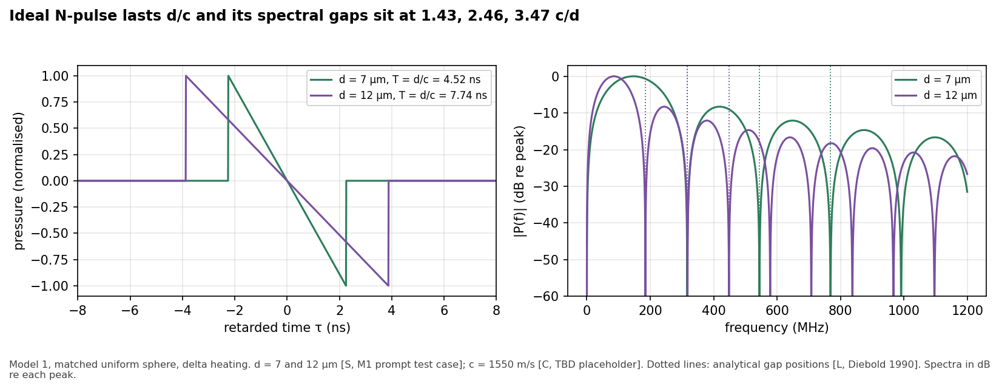
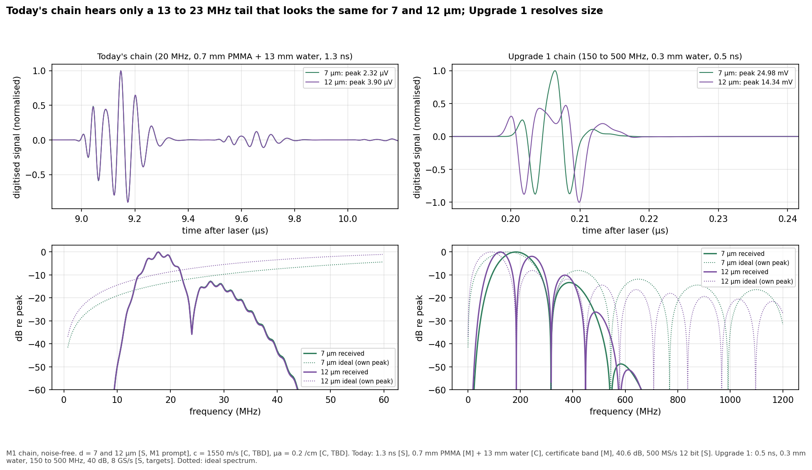
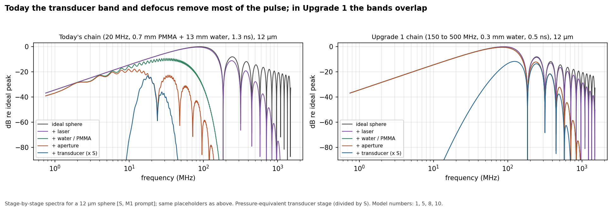
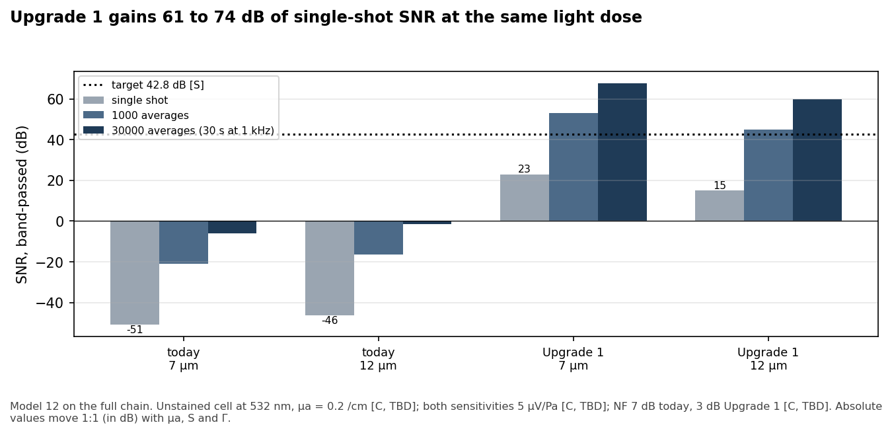
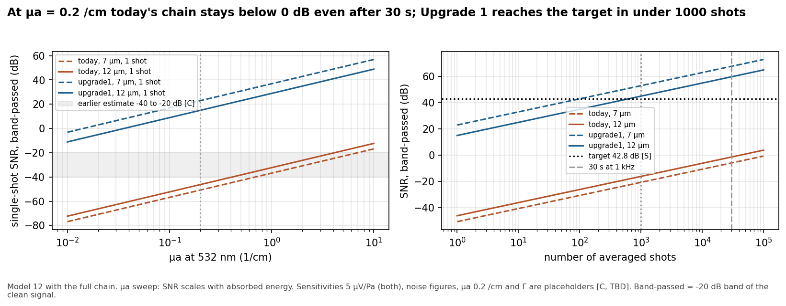
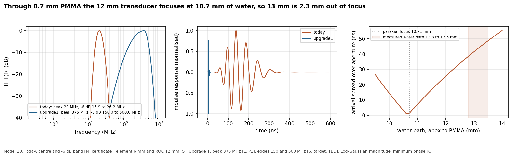
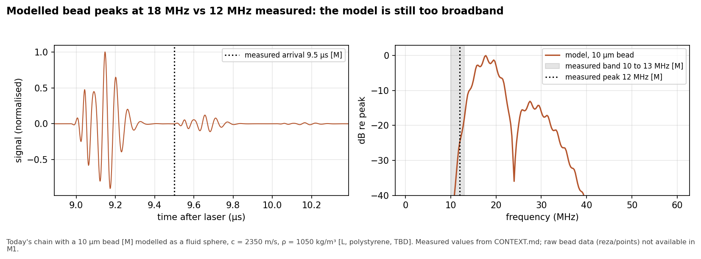

# Milestone M1 report: Analytical forward chain
Date 2026-10-30, version 1.0

## 1. Goal

Build the analytical forward chain (models 1, 5, 7 simple, 8, 10, 11 gain and noise, 12) that turns a uniformly heated sphere into a digitised, noisy trace, and run it for a 7 µm and a 12 µm sphere through today's instrument and through the Upgrade 1 receive chain. Deliver the ideal pulse and spectrum, the pulse through both chains, single-shot and averaged SNR, the six M1 pages, and every M1 verification check with a pass or fail.

**Short answer.** The chain works and all 32 internal checks pass. Today's chain hears only a 13 to 23 MHz tail whose shape is identical for 7 and 12 µm, and its single-shot SNR for an unstained cell is about -46 to -51 dB with the current placeholders. The Upgrade 1 chain keeps the size information (gaps at 1.43 c/d stay in place) and gains 61 to 74 dB of single-shot SNR at the same light dose. Four external comparisons fail; each needs a decision rather than a code fix (section 3). A by-product: today's transducer sits about 2.3 mm beyond its acoustic focus, which costs about 15 dB.

## 2. What was built

| # | Model | Module | Page |
|---|---|---|---|
| 1 | PA emission, uniform sphere (Diebold frequency-domain solution, matched and mismatched) | `src/u4/models/sphere_pa.py` | 01 PA sphere |
| 5 | Laser pulse (Gaussian, sech², top-hat) as low-pass filter | `laser.py` | 05 Laser pulse |
| 7 | Absorbed energy and p0, energy-equivalent uniform sphere | `absorption.py` | M1 Chain comparison |
| 8 | Water f² attenuation (temperature dependent) and the PMMA floor as a fluid layer | `water.py` | 08 Water attenuation |
| 10 | Transducer: log-Gaussian magnitude fitted to the -6 dB band, minimum phase; focal geometry by ray integration over the spherical cap through PMMA | `transducer.py` | 10 Transducer |
| 11 | Amplifier gain, first-order corners, Butterworth digitiser bandwidth, input noise density | `electronics.py` | 12 Noise and SNR |
| 12 | Folded noise PSD, quantisation, ADC noise, SNR (raw and band-passed), averaging | `noise.py` | 12 Noise and SNR |
| chain | Assembly of the above, presets `today` and `upgrade1` from `params.yaml` | `chain.py` | M1 Chain comparison |

Studies (`src/u4/studies/m1.py`, run with `python -m u4 run m1`): `m1_sphere`, `m1_laser`, `m1_absorption`, `m1_water`, `m1_transducer`, `m1_electronics`, `m1_noise`, `m1_chain`. Each records its checks, results, figures (PNG and SVG) and CSV data through the tracker. `scripts/m1_report_figures.py` re-runs all of them and copies the figures to `reports/figures/`. Tests: `tests/test_m1.py` asserts every internal check.

### 2.1 Signal chain

All stages are multiplied in the frequency domain on a 100 GS/s grid of 4 µs (retarded time, 0 = arrival of the sphere centre):

V(f) = P_sphere(f) · H_L(f) · H_W(f) · H_P(f) · H_SIR(f) · S · H_T(f) · H_E(f)

where P_sphere is the sphere spectrum at the apparent distance R_app (model 1, amplitude from model 7), H_L the laser pulse (5), H_W the water loss and H_P the PMMA plate (8), H_SIR the aperture integration and H_T the normalised transducer response with sensitivity S (10), and H_E the amplifier and digitiser response (11). The result is sampled at the digitiser rate and the noise model (12) is applied.

**Model 1.** For a fluid sphere of radius a = d/2, initial pressure p0, sound speed c_s and density ρ_s in a medium (c_f, ρ_f), at distance r and retarded time τ:

P(ω) = -i (p0 a² / (r c_s)) · (sin q - q cos q) / (q² D(q)) · exp(i ω a / c_f), with q = ω a / c_s and D = (1 - ρ̂) sin q / q - cos q - i ρ̂ ĉ sin q, ρ̂ = ρ_s/ρ_f, ĉ = c_s/c_f.

In the matched case this is the N-wave p = (p0 / 2r)(-c τ) for |τ| < a/c, of length T = d/c and peak p0 a / (2r). The numerator vanishes where tan q = q, i.e. at f = k_n c_s / d with k_n = 1.4303, 2.4590, 3.4709. For d = 12 µm and c_s = 1550 m/s: T = 12e-6 / 1550 = 7.74 ns and the first gap is 1.4303 × 1550 / 12e-6 = 184.7 MHz.

**Model 7 (simple).** E_abs = E (1 - exp(-µa d)), p0 = Γ E_abs / V, V = π d³/6. For d = 12 µm, E = 380 nJ, µa = 0.2 /cm = 20 /m, Γ = 0.12: E_abs = 380 nJ × (1 - exp(-20 × 12e-6)) = 91.2 pJ, V = 9.05e-16 m³, p0 = 0.12 × 91.2e-12 / 9.05e-16 = 12.1 kPa, and the temperature rise is 25 mK. For 7 µm: E_abs = 53.2 pJ, p0 = 35.5 kPa, 74 mK. Below the first gap the emitted pressure depends only on Γ E_abs (monopole), so the energy-equivalent sphere is exact there.

**Model 5.** For a Gaussian pulse of FWHM τ, H_L = exp(-(π f τ)² / (4 ln 2)); the half-amplitude point is f = 2 ln 2 / (π τ) = 0.441 / τ: 339 MHz at 1.3 ns, 883 MHz at 0.5 ns.

**Model 8.** Loss in dB = A3(T) f² L, with A3 from Francois and Garrison (1982). At 22 °C, A3 = 0.214 dB/(m MHz²). Today, 20 MHz over 13 mm: 0.214 × 20² × 0.013 = 1.1 dB. Upgrade 1, 375 MHz over 0.3 mm: 0.214 × 375² × 0.0003 = 8.8 dB. The PMMA floor is a fluid layer at normal incidence, T = 1 / (cos kL + (i/2)(m + 1/m) sin kL), m = Z_PMMA / Z_water.

**Model 10.** |H_T| = exp(-ln 2 (ln(f/f_c) / w)²) with w = ln(f_c/f_lo) below and ln(f_hi/f_c) above f_c, so |H_T| = 0.5 exactly at the band edges and 0 at DC; phase from the folded real cepstrum (minimum phase). Focal geometry: for an on-axis point source on top of the PMMA floor, each annulus of the spherical cap receives the wave after a travel time found by Snell refraction through the plate; the face-averaged pressure is p(R_app) convolved with the area-weighted spread of these times. Paraxially, R_app = W + L c_p / c_w and the cap is in focus at W_focus = R - L c_p / c_w = 12 - 0.7 × 2750 / 1488 = 10.71 mm of water. Upgrade 1 places the cell at focus (no spread).

**Model 11.** Input noise density e_n = sqrt(4 k_B T R_s F). Today, NF = 7 dB: e_n = sqrt(4 × 1.38e-23 × 295 × 50 × 5.01) = 2.02 nV/√Hz. Upgrade 1, NF = 3 dB: 1.28 nV/√Hz. Gains 40.6 dB and 40 dB.

**Model 12.** σ² = ∫ e_n² |H_E|² df folded into 0 to f_s/2, plus LSB²/12 and the ADC noise. SNR = 20 log10(max|s| / σ), reported on the raw trace and after a zero-phase band-pass over the band where the clean signal spectrum is within 20 dB of its peak (the headline number). N averages add 10 log10 N.

## 3. Verification

32 internal checks (code correctness) and 13 external comparisons (literature or bench). 41 of 45 pass. All 4 failures are external comparisons.

| Model | Check | Kind | Expected | Obtained | Result |
|---|---|---|---|---|---|
| 1 | Roots of tan x = x reproduce gap constants 1.4303, 2.4590, 3.4709 | internal | 1.4303, 2.4590, 3.4709 | 1.4303, 2.4590, 3.4709 | pass |
| 1 | Gap positions at 1.43, 2.46, 3.47 c/d (d = 7 µm), within 0.5 % | internal | 316.7, 544.5, 768.6 MHz | 316.7, 544.5, 768.5 MHz | pass |
| 1 | Ideal pulse length equals d/c (d = 7 µm), within 2 % | internal | 4.52 ns | 4.50 ns | pass |
| 1 | Frequency-domain solution equals exact N-wave in the matched case (d = 7 µm) | internal | < 1 % away from the pulse edges | 0.343 % (edges incl. Gibbs: 31 %) | pass |
| 1 | Gap positions at 1.43, 2.46, 3.47 c/d (d = 12 µm), within 0.5 % | internal | 184.7, 317.6, 448.3 MHz | 184.7, 317.6, 448.3 MHz | pass |
| 1 | Ideal pulse length equals d/c (d = 12 µm), within 2 % | internal | 7.74 ns | 7.72 ns | pass |
| 1 | Frequency-domain solution equals exact N-wave in the matched case (d = 12 µm) | internal | < 1 % away from the pulse edges | 0.235 % (edges incl. Gibbs: 40 %) | pass |
| 1 | Mismatched sphere (c_s/c_f = 1.05, rho_s/rho_f = 1.1): causal, zeros unchanged | internal | no signal before first arrival; zeros within 0.5 % | pre-arrival energy 5.4e-04; zero error 0.00 % | pass |
| 1 | CONTEXT.md example: 12 µm at 1550 m/s gives 7.7 ns | internal | 7.7 ns | 7.74 ns | pass |
| 5 | Gaussian half-amplitude (-6 dB) frequency equals 0.441 / FWHM | internal | 0.4413 | 0.4413 | pass |
| 5 | CONTEXT.md: cut-off about 340 MHz at 1.3 ns | external | 340 MHz (0.44 / tau) | 339.4 MHz | pass |
| 5 | gaussian: unit area and analytical spectrum equals FFT of pulse | internal | area 1, |dH| < 0.02 below 2 GHz | area 1.0000, |dH| 3.3e-16 | pass |
| 5 | sech2: unit area and analytical spectrum equals FFT of pulse | internal | area 1, |dH| < 0.02 below 2 GHz | area 1.0000, |dH| 4.4e-16 | pass |
| 5 | tophat: unit area and analytical spectrum equals FFT of pulse | internal | area 1, |dH| < 0.02 below 2 GHz | area 1.0000, |dH| 1.6e-04 | pass |
| 7 | 380 nJ in a 2.0 µm FWHM Gaussian spot gives the quoted 8.4 J/cm² peak | internal | 8.4 J/cm² [C] | 8.38 J/cm² | pass |
| 7 | Low-frequency limit equals monopole i w Gamma E_abs / (4 pi r c²) | internal | ratio 1 | max deviation 5.9e-05 | pass |
| 7 | Spot much smaller than cell (beam fully intercepted) | internal | spot < d/2 | 2.0 µm vs d = 7 µm | pass |
| 8 | Water at 20 °C: alpha/f² matches Pinkerton (1949), within 3 % | external | 0.00217 dB/(cm MHz²) [L] | 0.00220 dB/(cm MHz²) | pass |
| 8 | Two temperature branches agree at 20 °C, within 1 % | internal | continuous | 2.201e-04 vs 2.200e-04 dB/(km kHz²) | pass |
| 8 | Water sound speed at 20 °C (Marczak) equals 1482.3 m/s | external | 1482.3 m/s [L, Del Grosso and Mader 1972] | 1482.4 m/s | pass |
| 8 | P1 (as quoted in CONTEXT.md): ~20 dB over 50 µm at 1 GHz, 37 °C | external | 20 dB [L, P1] | 6.9 dB | **FAIL** |
| 8 | Lossless PMMA plate: |T| = 1 at half-wave, 2/(m + 1/m) at quarter-wave | internal | 1.000, 0.753 | 1.000, 0.753 | pass |
| 10 | Model reproduces certificate: centre 20.0 MHz, -6 dB 15.9 to 26.2 MHz | internal | 20.0; 15.9 to 26.2 MHz [M, certificate] | 20.0; 15.90 to 26.20 MHz | pass |
| 10 | Minimum-phase impulse response is causal and keeps the magnitude | internal | energy before t = 0 < 1e-6 | 3.7e-16 | pass |
| 10 | Point source at the geometric focus (no plate): all rays arrive together | internal | spread 0 ns | 1.69e-12 ns | pass |
| 10 | Focus through 0.7 mm PMMA: numerical best focus near paraxial R - L c_p/c_w | internal | 10.71 mm (paraxial) | 10.65 mm (ray trace, min spread 0.3 ns) | pass |
| 11 | Thermal noise of 50 ohm at 295 K equals 0.90 nV/sqrt(Hz) | internal | 0.903 nV/√Hz (4 k T R) | 0.903 nV/√Hz | pass |
| 11 | Today's gain 13.6 dB + 27 dB = 40.6 dB | internal | 40.6 dB | 40.6 dB | pass |
| 11 | Today's chain flat at 20 MHz; digitiser filter alone -3 dB at 250 MHz | internal | 0 dB at 20 MHz; -3.01 dB at 250 MHz | -0.01 dB; -3.01 dB (whole chain -3.98 dB incl. 500 MHz amplifier pole) | pass |
| 12 | Averaging 100 independent shots improves SNR by 20 dB (Monte Carlo) | internal | 20.0 dB | 20.03 dB | pass |
| 12 | Quantisation noise equals LSB / sqrt(12) | internal | 288.7 µV | 288.6 µV | pass |
| 12 | Aliasing (folding) conserves noise power | internal | ratio 1 | 1.000000 | pass |
| chain | Today's chain, 7 µm: spectrum peak near 12 to 20 MHz (bead behaviour) | external | 12 to 20 MHz [M, bead] | 17.8 MHz | pass |
| chain | Today's chain, 7 µm: ringing of hundreds of ns | external | >= 100 ns above -20 dB [M, bead] | 685 ns | pass |
| chain | Today's chain, 12 µm: spectrum peak near 12 to 20 MHz (bead behaviour) | external | 12 to 20 MHz [M, bead] | 17.8 MHz | pass |
| chain | Today's chain, 12 µm: ringing of hundreds of ns | external | >= 100 ns above -20 dB [M, bead] | 685 ns | pass |
| chain | Today's arrival time near the measured 9.5 µs (within 0.6 µs; trigger offset unknown) | external | 9.5 µs [M] | 8.99 µs | pass |
| chain | Today's single-shot SNR, 7 µm unstained cell, within -40 to -20 dB | external | -40 to -20 dB [C, CONTEXT.md] | -50.8 dB | **FAIL** |
| chain | Today's single-shot SNR, 12 µm unstained cell, within -40 to -20 dB | external | -40 to -20 dB [C, CONTEXT.md] | -46.3 dB | **FAIL** |
| chain | Today's amplitude loss vs ideal pulse, 7 µm, about 50 dB (within 10 dB) | external | 50 dB [C, CONTEXT.md] | 60.5 dB | **FAIL** |
| chain | Today's amplitude loss vs ideal pulse, 12 µm, about 50 dB (within 10 dB) | external | 50 dB [C, CONTEXT.md] | 51.4 dB | pass |
| chain | Upgrade 1 chain, 7 µm: gaps not moved by the instrument (within 1 %) | internal | 316.7, 544.5 MHz | 316.7, 544.5 MHz | pass |
| chain | Upgrade 1 chain, 12 µm: gaps not moved by the instrument (within 1 %) | internal | 184.7, 317.6 MHz | 184.7, 317.6 MHz | pass |
| chain | Ideal peak pressure: numerical vs analytical p0 a/(2R), 7 µm (Gibbs < 10 %) | internal | 207.3 Pa | 217.8 Pa | pass |
| chain | Ideal peak pressure: numerical vs analytical p0 a/(2R), 12 µm (Gibbs < 10 %) | internal | 120.9 Pa | 128.6 Pa | pass |

**Discussion of the four external failures** (item 2 covers two of them).

1. **P1 water loss (model 8).** CONTEXT.md quotes P1 as "about 20 dB over 50 µm at 1 GHz and 37 °C". The f² coefficient at 37 °C gives 6.9 dB (0.14 dB/µm at 1 GHz), and the same formula reproduces Pinkerton's 20 °C value within 1.5 %. 20 dB over 50 µm would need about 1.7 GHz, or 145 µm at 1 GHz, or the 20 °C value over 90 µm. I could not open the P1 full text in this session. I recommend that Yousef checks the P1 sentence; I kept the literature coefficient.
2. **Today's single-shot SNR (chain, 7 and 12 µm).** The model gives -50.8 and -46.3 dB against the earlier estimate of -40 to -20 dB. The chain is linear in µa, S and Γ, so this is a statement about the placeholders: the earlier range is reached for µa between 0.4 and 7 /cm (12 µm: 0.41 to 4.1 /cm; 7 µm: 0.69 to 6.9 /cm), or with a correspondingly more sensitive transducer. The bead cross-check below suggests the noise and sensitivity placeholders are of the right order, which leaves µa at 532 nm as the main open question.
3. **Amplitude loss for 7 µm (chain).** 60.5 dB versus the earlier 50 dB (the 12 µm case gives 51.4 dB and passes). The smaller cell puts even less of its spectrum into the 20 MHz band, so a 10 dB larger loss for 7 µm is expected physics, not a defect.

**Bead data.** The raw bead data (`reza/points`) was not available to this repository, so the comparison uses the values in CONTEXT.md only. A 10 µm bead modelled as a fluid polystyrene sphere (c = 2350 m/s, ρ = 1050 kg/m³ [L, TBD]) through today's chain gives: arrival 8.99 µs (measured 9.5 µs; 13.5 mm of water gives 9.32 µs, the rest is plausibly trigger delay), ringing of 685 ns including the PMMA reverberation every 0.51 µs (measured "hundreds of ns"), and a spectrum peak at 17.8 MHz (measured 12 MHz, band 10 to 13 MHz). The model is still too broadband on the low side. Candidate causes, in order of likelihood: the defocus spread is larger than modelled (water path measured from the rim rather than the apex, or a slightly different ROC), the HP preamp or booster rolls off above about 15 MHz, the bead's elastic (shear) resonances, which the fluid sphere ignores. To reach the measured 25 dB with 1000 averages (-5 dB per shot), the model needs Γ·E_abs = 3.1 nJ, i.e. 6.9 % of the 380 nJ absorbed if Γ = 0.12. That is plausible for a dyed bead and indicates that the sensitivity and noise placeholders are not off by orders of magnitude.

## 4. Key results

All numbers [C], computed from the placeholders listed in section 5 (µa = 0.2 /cm, S = 5 µV/Pa for both chains, NF 7 and 3 dB).

| Quantity | Today 7 µm | Today 12 µm | Upgrade 1 7 µm | Upgrade 1 12 µm |
|---|---|---|---|---|
| Ideal pulse length d/c | 4.52 ns | 7.74 ns | 4.52 ns | 7.74 ns |
| First / second gap | 316.7 / 544.5 MHz | 184.7 / 317.6 MHz | same | same |
| p0 (energy-equivalent) | 35.5 kPa | 12.1 kPa | 35.5 kPa | 12.1 kPa |
| Ideal peak at transducer (R_app 14.3 mm / 0.3 mm) | 4.35 Pa | 2.54 Pa | 207 Pa | 121 Pa |
| Peak of received spectrum | 17.8 MHz | 17.8 MHz | 183 MHz | 124 MHz |
| Ringing above -20 dB | 685 ns | 685 ns | 11 ns | 16 ns |
| Amplitude kept vs ideal pulse | -60.5 dB | -51.4 dB | -12.8 dB | -13.0 dB |
| SNR, 1 shot, band-passed (raw trace) | -50.8 dB (-63.2) | -46.3 dB (-58.7) | 22.9 dB (13.3) | 14.9 dB (8.5) |
| SNR, 1000 averages | -20.8 dB | -16.3 dB | 52.9 dB | 44.9 dB |
| SNR, 30 000 averages (30 s at 1 kHz) | -6.0 dB | -1.5 dB | 67.7 dB | 59.7 dB |
| Shots for the 42.8 dB target | 2.3e9 | 8.1e8 | 98 | 613 |

Figure 1. Model 1: the ideal N-pulse lasts d/c and its gaps sit at 1.43, 2.46 and 3.47 c/d.

Figure 2. Through today's chain the 7 and 12 µm waveforms are indistinguishable after normalisation (only the amplitude differs, 2.3 versus 3.9 µV). Through the Upgrade 1 chain the shapes differ and the gaps remain exactly where model 1 puts them.

Figure 3. Where the signal is lost, 12 µm sphere. Today: 13 mm of water removes everything above about 150 MHz, the defocused aperture adds notches every 24 MHz (1 / 41.6 ns), and the 20 MHz band keeps only the low-frequency tail. Upgrade 1: the transducer band overlaps the main lobe of the source spectrum.

Figure 4. Single-shot and averaged SNR. The Upgrade 1 advantage of 61 to 74 dB comes from the shorter distance (14.3 mm to 0.3 mm, 34 dB by 1/r), the band match (about 38 to 48 dB less amplitude loss) and the lower placeholder noise figure (4 dB), partly offset by the wider noise bandwidth.

Figure 5. SNR scales one to one (in dB) with absorbed energy. The earlier -40 to -20 dB range corresponds to µa of roughly 0.4 to 7 /cm in this model.

Figure 6. Through 0.7 mm PMMA the 12 mm transducer focuses at 10.7 mm of water. At 13 mm the arrival times across the 6 mm aperture spread by 41.6 ns. Moving to 10.7 mm would raise today's single-shot SNR for a 12 µm cell from -46.3 to -31.4 dB in the model. The measured 9.5 µs arrival is consistent with the bench being at about 13 to 13.5 mm (in focus it would arrive at 7.4 µs).

Figure 7. Bead case: arrival and ringing agree qualitatively; the modelled spectrum peak (17.8 MHz) is above the measured 12 MHz.

Further figures: `M1_laser_filter`, `M1_p0_vs_mua`, `M1_water_pmma`, `M1_electronics` (all in `reports/figures/`, PNG and SVG).

## 5. Assumptions and placeholders (TBD list)

Every item is marked `tbd: true` in `params.yaml` and listed live on the board.

| Parameter | Placeholder used | Tag | Why it matters |
|---|---|---|---|
| Cell sound speed | 1550 m/s | [C] (M1 prompt; literature 1560 to 1575 [L, P2]) | gap positions scale with c |
| Cell density | 1000 kg/m³ | [C] | mismatch ringing (small) |
| Cell Grüneisen Γ | 0.12 | [L, water] | SNR one to one |
| Cell heat capacity | 4000 J/(kg K) | [L, water-like] | temperature rise only |
| µa at 532 nm, unstained cell | 0.2 /cm | [C], estimate from ~10 µM cytochromes | SNR one to one; largest uncertainty |
| Jurkat / T-cell diameters | 11 to 12 µm / 7 µm | [L], to verify | test cases are the prompt's 7 and 12 µm |
| Nucleus ratio, mitochondrial load, compartment c and µa | none | [L] | not used in M1 |
| Today: laser pulse shape | Gaussian | [C] | high-frequency roll-off only |
| Today: water path reference (apex or rim) and temperature | 13.0 mm from apex, 22 °C | [M]/[C] | defocus, arrival, spectrum peak |
| Today: transducer sensitivity | 5 µV/Pa into 50 Ω | [C], from PVDF g33 and thickness | SNR one to one |
| Today: preamp noise figure, source resistance, noise temperature | 7 dB, 50 Ω, 295 K | [C] | SNR |
| Today: amplifier corners | 0.1 MHz, 500 MHz | [C] | small; may explain the 12 MHz bead peak if the real roll-off is lower |
| Today: digitiser filter order, input range, ADC noise | 2nd order, ±0.4 V, 1 LSB | [C] | small |
| Bead material (c, ρ) | 2350 m/s, 1050 kg/m³ | [L, polystyrene] | bead comparison only |
| PMMA sound speed and attenuation | 2750 m/s, 0.5 dB/(cm MHz), n = 1 | [L, typical] | ripple and arrival |
| Upgrade 1: pulse shape, pulse energy, water temperature | Gaussian, 380 nJ, 22 °C | [C] | |
| Upgrade 1: transducer band edges | 150 and 500 MHz around a 375 MHz peak | [S] target, P1 bandwidth not read | spectrum shape |
| Upgrade 1: focal length | 0.3 mm (cell at focus) | [C] | 1/r gain |
| Upgrade 1: sensitivity | 5 µV/Pa (equal to today on purpose) | [C] | SNR one to one |
| Upgrade 1: LNA noise figure, corners, source resistance | 3 dB, 1 MHz to 2 GHz, 50 Ω | [C] | SNR |
| Upgrade 1: digitiser bits, bandwidth, filter order, range, ADC noise | 12 bit, 2.5 GHz, 2nd order, ±0.5 V, 1 LSB | [C] | small |
| Upgrade 1: averages | 1000 | [C] | |
| Upgrade 2: pulse durations at 266 and 420 nm | 0.5 ns | [C] | not used in M1 |

Values taken from CONTEXT.md without a stated tag (tag assigned, please confirm): water path 12.8 to 13.5 mm [M], chamber depth 100 µm [S], 30 s budget and 42.8 dB target [S].

## 6. Limits of validity

- Uniform sphere with uniform heating. The real spot (2 µm FWHM) heats a column through the cell; this is exact below the first gap (monopole limit) but changes the high-frequency spectrum that matters for Upgrade 1 (model 6, M4).
- Fluid sphere, no shear; a solid bead has additional elastic resonances.
- Free-standing sphere: no floor, agar or reverberation from the dish (model 9, M3). Today's PMMA floor is modelled only as a transmission layer at normal incidence.
- On-axis source only; lateral offset and the oblique transmission through PMMA are not modelled.
- Dispersion of water attenuation neglected (zero-phase loss).
- SNR assumes white, uncorrelated noise between shots; no laser energy jitter, trigger jitter, drift or LNA recovery (M3).
- All absolute SNR values carry the placeholders µa, Γ, S and NF linearly (in dB); the chain-to-chain difference is more robust than the absolute numbers.
- The P1 bandwidth and focal geometry of the 375 MHz unit could not be read; the Upgrade 1 transducer is a band-target model, not P1's measured response.

## 7. Recommendation for the next milestone

Proceed to M2 (identifiability), with four decisions first:

1. **µa at 532 nm and transducer sensitivity.** These set every absolute SNR. A measured sensitivity from the PA3421 certificate (or a hydrophone substitution) and the raw bead data would let me calibrate today's chain properly instead of using estimates.
2. **P1 water attenuation.** Please check the sentence in P1 behind "20 dB over 50 µm at 1 GHz". I recommend keeping the Francois and Garrison coefficient unless P1 states a measured value.
3. **Today's focus.** Confirm whether the 12.8 to 13.5 mm water path is measured from the transducer apex. If it is, refocusing to about 10.7 mm is a cheap bench test that the model predicts to gain about 15 dB.
4. **Bead data.** Copy `reza/points` into `data/` (read only) so the qualitative comparison can become a quantitative one (spectrum peak, ringing, arrival, SNR definition).

M2 can start on the current chain: it does not depend on the absolute SNR level, only on how SNR, bandwidth and pulse length limit the recovery of d, c and the gap positions.
